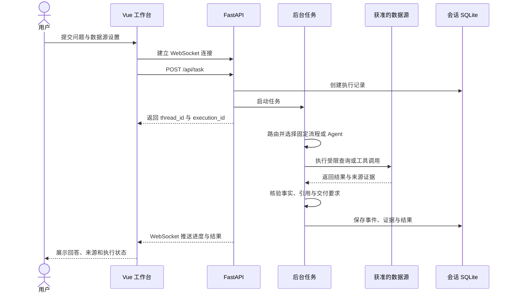

# Patent Casework Assistant

面向专利代理部门的案件与文档分析工作台。代理师可以在这里查案卷、核对办理记录、准备客户会议；部门负责人可以查看业务量和分案参考。结果尽量带回案号、原文位置和文件版本，方便回到材料核实。


*首页截图展示模拟业务场景。*


*模拟扫描交底任务：左侧为会话，中间为带原文位置的结果，右侧为执行过程。*

## 典型业务任务

工作台主要处理散落在共享盘和业务记录中的案件资料。下面是当前界面和任务入口覆盖的几类工作；附件分析、公开资料检索、图表和报告是完成这些工作的方式。

| 场景 | 用户可能这样问 | 系统提供什么 |
| --- | --- | --- |
| 交底与旧案对照 | “我上传了新交底，我们以前办过类似机制的案子吗？” | 从交底提取待核对的问题，按案找技术原文，列出相似点和资料缺口 |
| 案件办理核对 | “这个案子谁负责？初稿、送审和交局期限分别是什么？” | 汇集案件信息、期限和原文出处；缺失或冲突的字段单列 |
| 客户会议准备 | “以前谁和这位客户 IPR 开过会？当时还缺什么材料？” | 按场会议列出日期、参会人、关联案件和待补事项 |
| 部门统计与汇报 | “9 月和 10 月各收了多少案、实际交局多少件？” | 按实际日期核对数量和明细；按任务需要生成图表或报告 |
| 辅助分案 | “谁办过类似技术？他们手头的案量和近期期限怎样？” | 提供有原文依据的经历、登记负荷和期限，供负责人决定 |

“案件”页面适合按已有口径查资料；会话入口可以处理附件、跨来源比较和报告任务。固定流程也可能查多个来源、分几步完成。需求超出已有流程时，DeepAgents 才在获准的数据源和预算内决定后续查询。两条路径都受本次任务的数据源设置约束。

## 系统结构


两条执行路径都会记录来源编号、原文位置和版本。固定流程由程序确定查询参数并核验业务事实；开放任务由 Agent 选择工具，发现证据不足时在预算内补查或修正。图展示主要关系，具体边界见[固定流程与 Agent 执行](docs/execution-boundaries.md)和[来源权限](docs/task-source-selection.md)。

### 固定流程与 Agent 如何分工

| 执行路径 | 谁决定下一步 | 适合的任务 |
| --- | --- | --- |
| 固定业务流程 | 程序将已支持的需求编译为受限参数，按既定规则查询、计算和核验 | 查指定案件信息、逐场会议、明确月份的收案与交局统计 |
| Agent 会话任务 | DeepAgents 在允许的数据源和执行预算内，根据已取得的结果选择后续工具与查询 | 阅读附件后比较旧案、跨来源补查、整理报告 |

任务模式和工具调用次数不能单独说明走了哪条路径。程序会检查已有流程能否覆盖完整需求，并核对所需数据源是否开放；缺少资料或关键条件时，结果会说明缺口，必要时请用户补充。

### 一次会话如何返回结果



前端先连 WebSocket，再提交任务。后台将执行事件存入应用 SQLite；连接中断后，前端可读取运行记录恢复状态。如果统计口径等关键条件不清楚，任务会暂停，等用户补充后再执行。

### 数据放在哪里

| 数据 | 当前存储 | 用途 |
| --- | --- | --- |
| 会话、执行事件与证据 | 应用 SQLite | 恢复任务进度和查看结果来源 |
| 案件目录、原件版本与正文分块 | 案件 SQLite 与本地文件 | 保留案号、原文位置和版本 |
| 结构化业务记录 | MySQL | 查询案件信息、会议和统计所需字段 |
| 公司文档知识库 | Chroma 与词法索引 | 检索单独导入的公司文档 |

案卷和公司文档分别建索引，检索范围也各自独立。

<details>
<summary>展开：任务路由与核验图</summary>


</details>

### 文件如何进入结果


共享盘原件按白名单只读扫描；案件信息与会议字段保留候选值及冲突，案卷正文保存分块、位置、哈希和解析版本。当前案卷召回使用本地 **Qwen3-Embedding-0.6B + BM25**，条件满足时使用 **bge-reranker-base** 重排；普通知识库独立维护 Chroma 与词法索引。向量不可用时，部分查询可退回词法路径并显示状态。

文本 PDF 优先读取原生文字；扫描页、图片和复杂版面按配置使用本地 MinerU 解析。纯图形可由单独的视觉工具观察。详见[文档解析](docs/document-parsing.md)。三张图的可编辑源和生成命令见[图稿说明](docs/diagrams/README.md)。

## 运行演示

环境：Python 3.12+、[uv](https://docs.astral.sh/uv/)、Node.js 22、Docker。以下命令均在本 README 所在目录执行。

```bash
uv sync --locked
cp .env.example .env
npm --prefix frontend ci
npm --prefix frontend run build
docker compose up -d mysql
```

在 `.env` 中配置业务数据库连接及生成模型的 OpenAI 兼容接口。生成任务需要可用的模型端点；本地向量模型权重位于被 Git 忽略的 `models/`，新克隆需按 `.env.example` 准备 `EMBEDDING_MODEL_PATH` 等路径。保密资料应连接获准的本地模型端点。

首次建立**较小的部门模拟场景**时，运行：

```bash
PYTHONPATH=. .venv/bin/python scripts/setup_department_demo.py --activate
.venv/bin/python scripts/build_knowledge_base.py
.venv/bin/python main.py
```

启动后访问 `http://localhost:8000`，健康检查为 `/api/health`。激活脚本会备份本机旧配置和应用库，并创建演示数据库与分离账号；它只在首次初始化时运行。同步与部署细节见[部署说明](docs/department-deployment.md)。MinerU 本地环境按需使用 `scripts/setup_mineru.sh` 安装。

## 本地检查

运行后端测试与前端构建：

```bash
.venv/bin/python scripts/test_backend_offline.py
npm --prefix frontend test
npm --prefix frontend run build
```

## 代码导航

| 目录 | 职责 |
| --- | --- |
| [`frontend/`](frontend/) | Vue 3 工作台、来源和执行详情、图表与报告 |
| [`api/`](api/) | FastAPI、WebSocket、会话、附件和管理接口 |
| [`casework/`](casework/) | 案件信息、共享盘同步、检索、统计与推荐 |
| [`agent/`](agent/) · [`harness/`](harness/) | DeepAgents 编排与上下文预算 |
| [`tools/`](tools/) · [`rules/`](rules/) | 数据访问、证据核验、文档工具与长期规则 |
| [`deploy/`](deploy/) · [`docs/`](docs/) | 部署配置与详细设计 |

本仓库不包含 `.env`、运行数据库、会话附件或本地模型权重。
