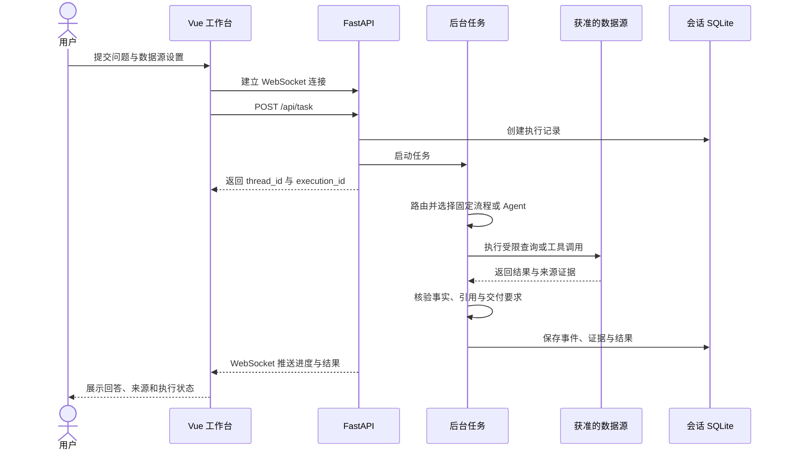

# Patent Casework Assistant

面向专利代理部门的案件与文档分析工作台。它把共享盘中的**案件信息**、会议记录、技术交底和申请正文连接起来，让查询结果能回到具体案号、原文位置与文件版本。


*首页截图展示模拟业务场景；拍摄时页面仍显示更名前的标题。*

## 能解决什么问题

| 业务任务 | 用户可能这样问 | 可核对的交付 |
| --- | --- | --- |
| 查相似旧案 | “新交底用了近邻检索，之前有没有机制接近的案子？” | 按案归并的候选、技术原文、来源位置与版本；否定提及不冒充采用证据 |
| 查会前经历 | “以前谁和这位客户 IPR 开过会？当时待补什么？” | 逐场会议的实际参会人、日期、案号和待补材料 |
| 做月度统计 | “9 月和 10 月实际收案、交局各是多少？” | 按实际日期计数、明细及口径；缺失或冲突单列 |
| 辅助分案 | “谁有相关经历，近期登记负荷怎样？” | 有原文依据的历史经历、在办案量和三个期限；由负责人确认分案 |

用户既可在“案件”工作台按固定口径查询，也可在会话中提交附件分析、技术比较或报告任务。**固定流程也能使用多个来源、执行多个步骤**；当已有契约不能完整覆盖要求时，由 DeepAgents 在获准来源和预算内决定后续查询。来源选择限制两条路径可访问的数据。

## 系统结构


图中的执行路径共同保留来源编号、原文位置和版本。固定业务流程由程序编译受限参数并核验业务事实；开放任务由 Agent 规划工具调用、检查证据缺口并进行有界修正。图是实现概览，详细边界见[固定流程与 Agent 执行](docs/execution-boundaries.md)和[来源权限](docs/task-source-selection.md)。

### 固定流程与 Agent 如何分工

| 执行路径 | 谁决定下一步 | 适合的任务 |
| --- | --- | --- |
| 固定业务流程 | 程序将已支持的需求编译为受限参数，按既定规则查询、计算和核验 | 查指定案件信息、逐场会议、明确月份的收案与交局统计 |
| Agent 会话任务 | DeepAgents 在允许的数据源和执行预算内，根据已取得的结果选择后续工具与查询 | 阅读附件后比较旧案、跨来源补查、整理报告 |

任务模式或工具调用次数本身不能区分两条路径：固定流程也可能查询多个来源；Agent 也可能一步完成。路由会检查需求是否被固定契约完整覆盖，并在执行前检查所需数据源。数据源未开放或关键条件缺失时，系统会说明缺口或请求补充，不把缺失的事实写成已核实结论。

### 一次会话如何返回结果



前端先连接 WebSocket，再提交任务；后台执行产生的事件会保存到应用 SQLite。连接中断后，前端可通过运行记录接口恢复执行状态。任务需要补充业务口径时，会停在澄清状态，收到用户回答后再启动一次执行。

### 数据放在哪里

| 数据 | 当前存储 | 用途 |
| --- | --- | --- |
| 会话、执行事件与证据 | 应用 SQLite | 恢复任务进度和查看结果来源 |
| 案件目录、原件版本与正文分块 | 案件 SQLite 与本地文件 | 保留案号、原文位置和版本 |
| 结构化业务记录 | MySQL | 查询案件信息、会议和统计所需字段 |
| 公司文档知识库 | Chroma 与词法索引 | 检索单独导入的公司文档 |

案卷检索与公司文档知识库分别建立索引，不能把两者视为同一套文档库。

<details>
<summary>展开：任务路由与核验图</summary>


</details>

### 文件如何进入结果


共享盘原件按白名单只读扫描；案件信息与会议字段保留候选值及冲突，案卷正文保存分块、位置、哈希和解析版本。当前案卷召回使用本地 **Qwen3-Embedding-0.6B + BM25**，条件满足时使用 **bge-reranker-base** 重排；普通知识库独立维护 Chroma 与词法索引。向量不可用时，部分查询可退回词法路径并显示状态。

文本 PDF 优先读取原生文字；扫描页、图片和复杂版面按配置使用本地 MinerU 解析。纯图形可由单独的视觉工具观察。详见[文档解析](docs/document-parsing.md)。三张图的可编辑源和生成命令见[图稿说明](docs/diagrams/README.md)。

## 运行演示

环境：Python 3.12+、[uv](https://docs.astral.sh/uv/)、Node.js 22、Docker。以下命令均在本 README 所在目录执行。

```bash
uv sync --locked
cp .env.example .env
npm --prefix frontend ci
npm --prefix frontend run build
docker compose up -d mysql
```

在 `.env` 中配置业务数据库连接及生成模型的 OpenAI 兼容接口。生成任务需要可用的模型端点；本地向量模型权重位于被 Git 忽略的 `models/`，新克隆需按 `.env.example` 准备 `EMBEDDING_MODEL_PATH` 等路径。保密资料应连接获准的本地模型端点。

首次建立**较小的部门模拟场景**时，运行：

```bash
PYTHONPATH=. .venv/bin/python scripts/setup_department_demo.py --activate
.venv/bin/python scripts/build_knowledge_base.py
.venv/bin/python main.py
```

启动后访问 `http://localhost:8000`，健康检查为 `/api/health`。激活脚本会备份本机旧配置和应用库，并创建演示数据库与分离账号；它只在首次初始化时运行。同步与部署细节见[部署说明](docs/department-deployment.md)。MinerU 本地环境按需使用 `scripts/setup_mineru.sh` 安装。

## 本地检查

运行后端测试与前端构建：

```bash
.venv/bin/python scripts/test_backend_offline.py
npm --prefix frontend test
npm --prefix frontend run build
```

## 代码导航

| 目录 | 职责 |
| --- | --- |
| [`frontend/`](frontend/) | Vue 3 工作台、来源和执行详情、图表与报告 |
| [`api/`](api/) | FastAPI、WebSocket、会话、附件和管理接口 |
| [`casework/`](casework/) | 案件信息、共享盘同步、检索、统计与推荐 |
| [`agent/`](agent/) · [`harness/`](harness/) | DeepAgents 编排与上下文预算 |
| [`tools/`](tools/) · [`rules/`](rules/) | 数据访问、证据核验、文档工具与长期规则 |
| [`deploy/`](deploy/) · [`docs/`](docs/) | 部署配置与详细设计 |

本仓库不包含 `.env`、运行数据库、会话附件或本地模型权重。
