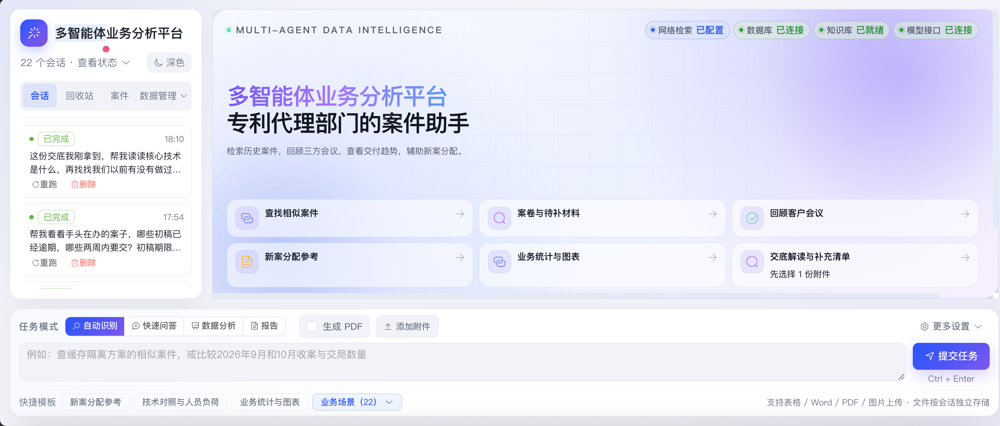
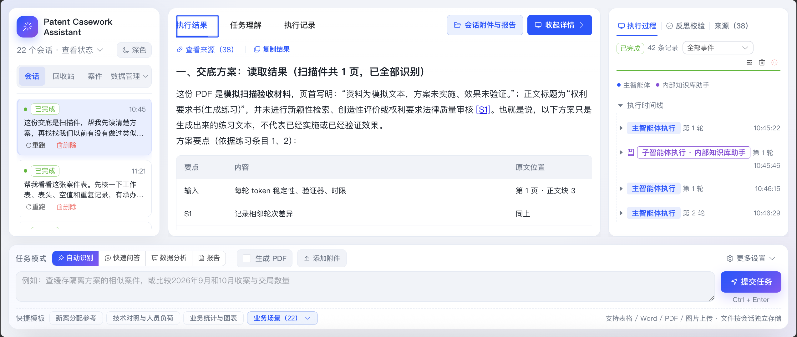
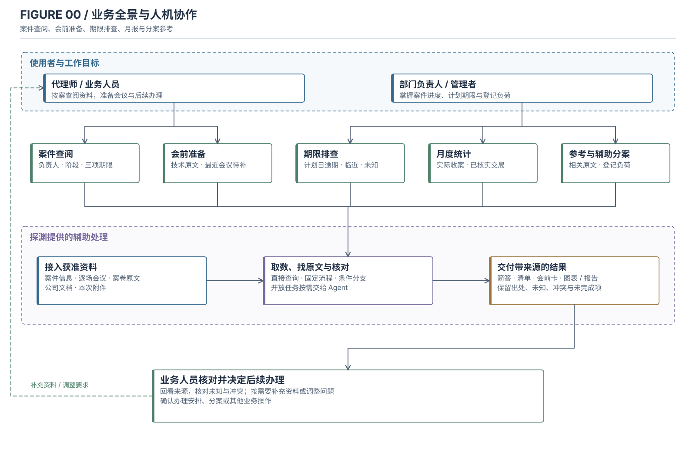
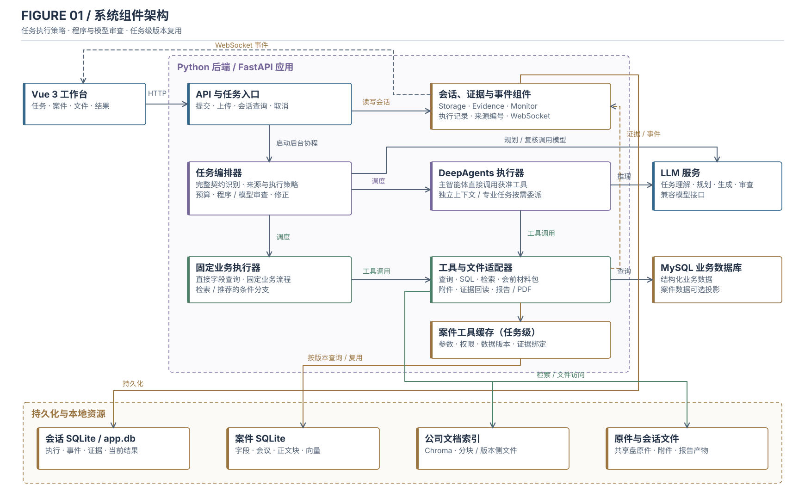
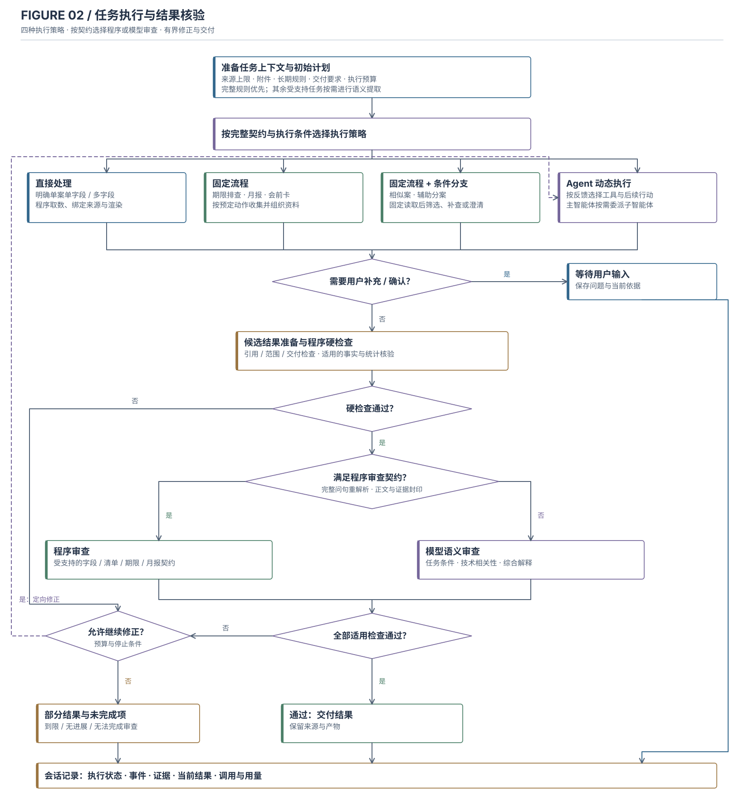
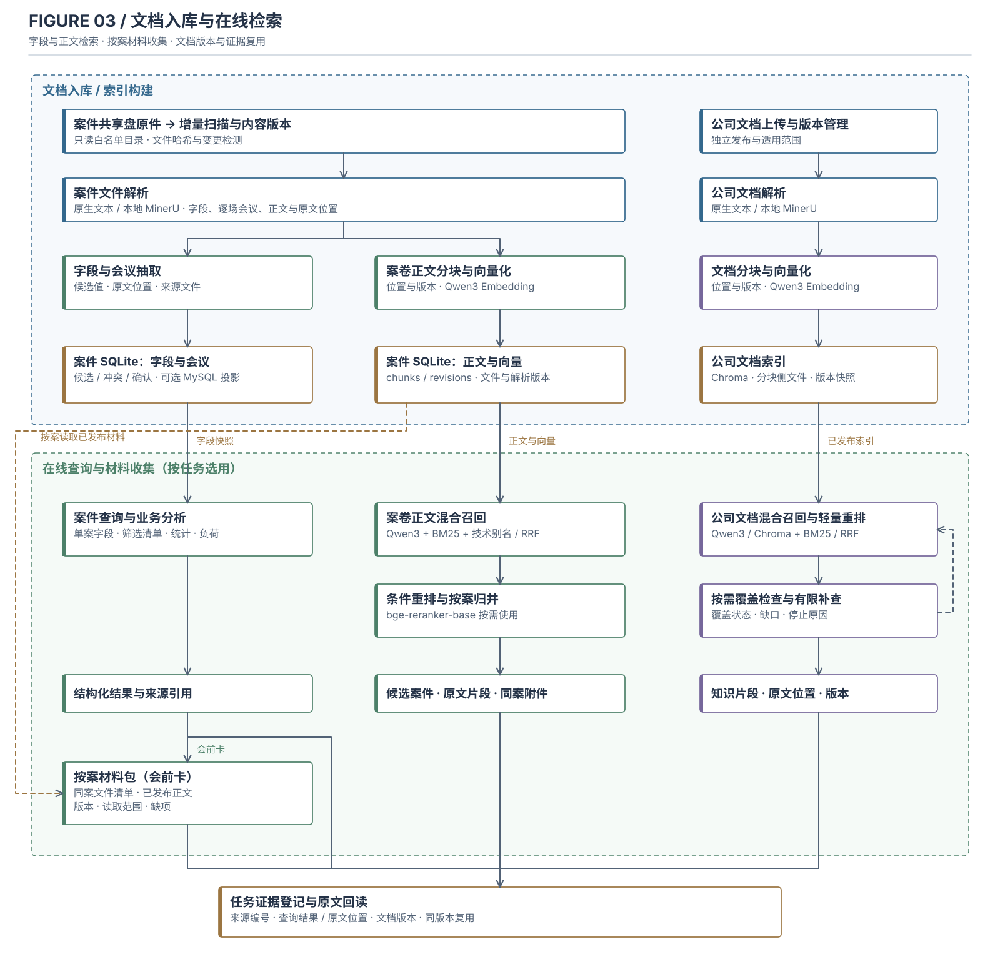
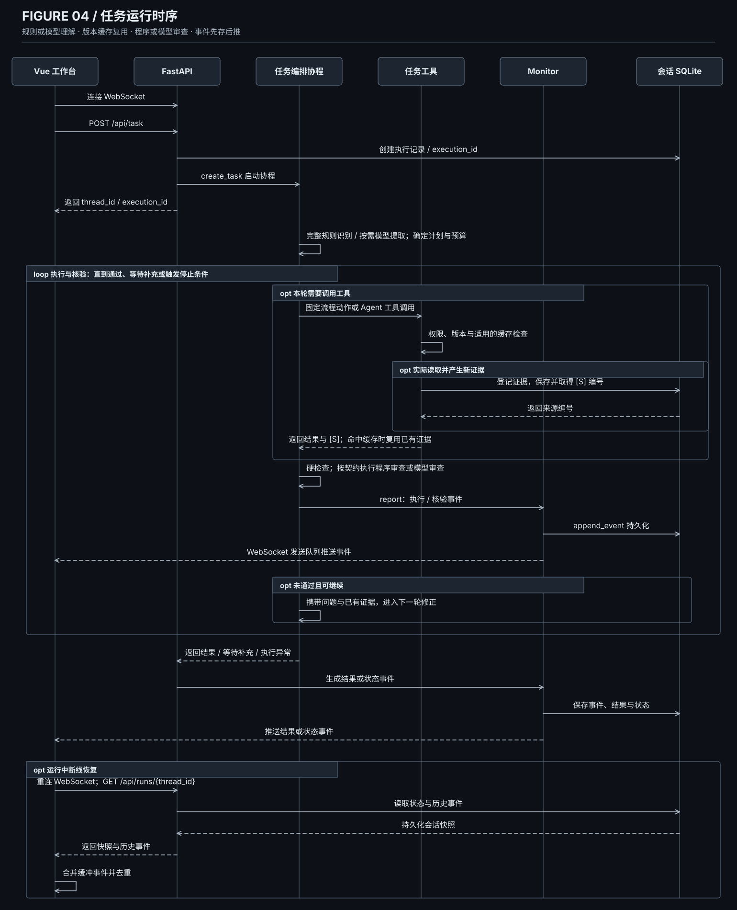

# Patent Casework Assistant

面向专利代理部门的案件与文档分析工作台。代理师可以在这里查案卷、核对办理记录、准备客户会议；部门负责人可以查看业务量和分案参考。结果尽量带回案号、原文位置和文件版本，方便回到材料核实。



*首页截图展示模拟业务场景。*



*模拟扫描交底任务：左侧为会话，中间为带原文位置的结果，右侧为执行过程。*

## 典型业务任务

工作台主要处理散落在共享盘和业务记录中的案件资料。下面是当前界面和任务入口覆盖的几类工作；附件分析、公开资料检索、图表和报告是完成这些工作的方式。

| 场景 | 用户可能这样问 | 系统提供什么 |
| --- | --- | --- |
| 交底与旧案对照 | “我上传了新交底，我们以前办过类似机制的案子吗？” | 从交底提取待核对的问题，按案找技术原文，列出相似点和资料缺口 |
| 案件办理核对 | “这个案子谁负责？初稿、送审和交局期限分别是什么？” | 汇集案件信息、期限和原文出处；缺失或冲突的字段单列 |
| 客户会议准备 | “以前谁和这位客户 IPR 开过会？当时还缺什么材料？” | 按场会议列出日期、参会人、关联案件和待补事项 |
| 部门统计与汇报 | “9 月和 10 月各收了多少案、实际交局多少件？” | 按实际日期核对数量和明细；按任务需要生成图表或报告 |
| 辅助分案 | “谁办过类似技术？他们手头的案量和近期期限怎样？” | 提供有原文依据的经历、登记负荷和期限，供负责人决定 |

“案件”页面适合按已有口径查资料；会话入口可以处理附件、跨来源比较和报告任务。明确字段由程序直接查询，固定任务按预定步骤执行，需要动态探索的任务由 DeepAgents 根据返回结果选择下一步。所有执行策略都受本次任务的数据源设置约束。

## 业务全景



## 系统结构



后端使用 FastAPI，结合固定业务流程与 DeepAgents 处理不同任务。案件资料和公司文档分别建立索引，执行过程与来源随会话保存。

### 固定流程与 Agent 如何分工

| 执行策略 | 谁决定下一步 | 适合的任务 |
| --- | --- | --- |
| 直接查询 | 程序取数并输出 | 同一案件的负责人、阶段和多个期限字段 |
| 固定流程 | 程序按既定步骤执行，模型按需参与 | 期限排查、月度统计、固定会前卡 |
| 固定流程加条件分支 | 固定读取起步，再按结果筛选、补查或澄清 | 相似案件查找、辅助分案 |
| Agent 动态执行 | DeepAgents 根据已取得的结果选择后续工具，按需委派子智能体 | 阅读附件后比较旧案、跨来源分析、整理报告 |

程序根据完整需求选择策略；资料不足或关键条件不明确时，请用户补充。提交区可以选择业务数据库、知识库和联网检索，默认关闭联网。

### 任务执行流程



### 文件如何进入结果



共享盘资料解析后分别用于结构化查询和正文检索。案卷检索使用本地 **Qwen3-Embedding-0.6B + BM25**，按需使用 **bge-reranker-base** 重排；公司文档使用 Chroma 与词法索引。

文本 PDF 优先读取原生文字，扫描页和复杂版面按配置使用本地 MinerU 解析。详见[文档解析](docs/document-parsing.md)。

### 任务运行时序



前端通过 WebSocket 展示执行进度，断线后可恢复已保存的运行记录。[查看图稿](docs/diagrams/README.md)。

## 运行演示

环境：Python 3.12+、[uv](https://docs.astral.sh/uv/)、Node.js 22、Docker。以下命令均在本 README 所在目录执行。

```bash
uv sync --locked
cp .env.example .env
npm --prefix frontend ci
npm --prefix frontend run build
docker compose up -d mysql
```

在 `.env` 中配置业务数据库连接及生成模型的 OpenAI 兼容接口。生成任务需要可用的模型端点；本地向量模型权重位于被 Git 忽略的 `models/`，新克隆需按 `.env.example` 准备 `EMBEDDING_MODEL_PATH` 等路径。保密资料应连接获准的本地模型端点。

首次建立部门模拟场景时，运行：

```bash
PYTHONPATH=. .venv/bin/python scripts/setup_department_demo.py --activate
.venv/bin/python scripts/build_knowledge_base.py
.venv/bin/python main.py
```

启动后访问 `http://localhost:8000`，健康检查为 `/api/health`。激活脚本会备份本机旧配置和应用库，并创建演示数据库与分离账号；它只在首次初始化时运行。同步与部署细节见[部署说明](docs/department-deployment.md)。MinerU 本地环境按需使用 `scripts/setup_mineru.sh` 安装。

## 本地检查

运行后端测试与前端构建：

```bash
.venv/bin/python scripts/test_backend_offline.py
npm --prefix frontend test
npm --prefix frontend run build
```

## 代码导航

| 目录 | 职责 |
| --- | --- |
| [`frontend/`](frontend/) | Vue 3 工作台、来源和执行详情、图表与报告 |
| [`api/`](api/) | FastAPI、WebSocket、会话、附件和管理接口 |
| [`casework/`](casework/) | 案件信息、共享盘同步、检索、统计与推荐 |
| [`agent/`](agent/) · [`harness/`](harness/) | DeepAgents 编排与上下文预算 |
| [`tools/`](tools/) · [`rules/`](rules/) | 数据访问、证据核验、文档工具与长期规则 |
| [`deploy/`](deploy/) · [`docs/`](docs/) | 部署模板与使用说明 |

本仓库不包含 `.env`、运行数据库、会话附件或本地模型权重。
