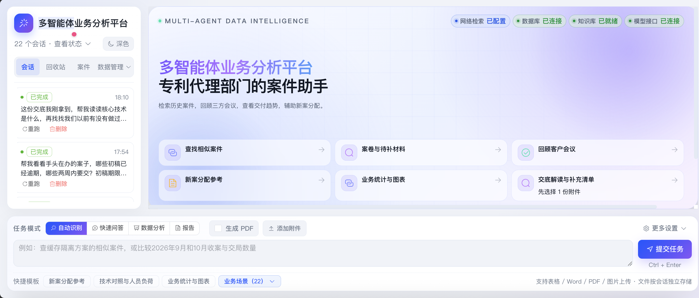
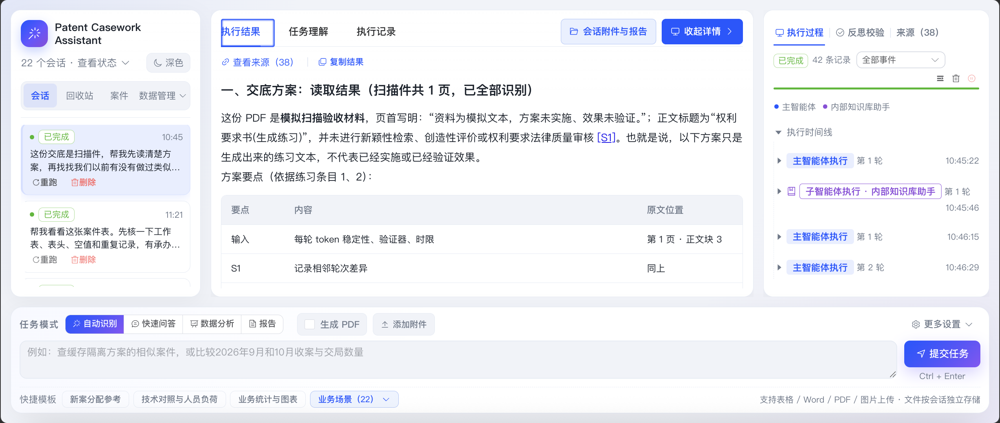
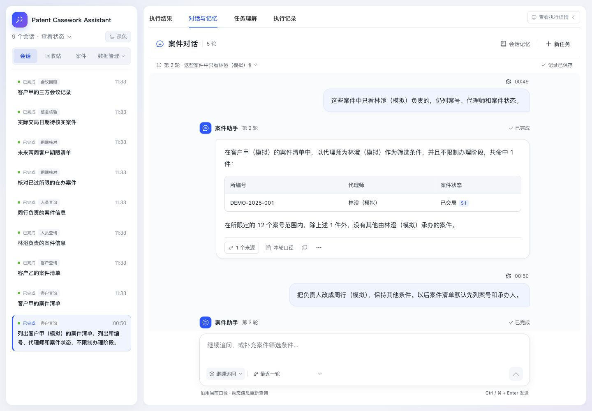

# Patent Casework Assistant

案件助手是面向专利代理部门的案件与文档工作台。通过自然语言查询案件信息、核对期限、回顾会议、检索参考材料和分析业务数据，在同一会话中继续追问，并从回答打开对应来源。

项目提供模拟案件资料，便于本地运行和体验业务流程。







## 业务场景

| 场景 | 使用方式 |
| --- | --- |
| 案件信息与期限核对 | 查询承办人、客户、办理阶段、三项计划期限及实际收案、交局日期，查看字段出处 |
| 会议回顾与待办整理 | 按客户、联系人或案件查找会议记录，整理沟通内容、待补材料和登记责任人 |
| 部门统计与图表 | 按月份、承办人等条件统计收案、交局和在办案量，查看明细、日期缺失项及图表 |
| 新案分配参考 | 结合相关案卷、办理经历和登记负荷整理候选，供主管选择 |
| 两份案件表核对 | 按共有案号对齐 Excel 或 CSV，列出新增、删除及字段变化，保留两侧行号 |
| 上传表格分析 | 按实际字段筛选、按指定主键去重和聚合，生成统计表与图表，保留来源行 |
| 两版技术文档对照 | 对齐解析文字，列出新增、删除、修改和未变化的原句，标注两侧位置 |
| 交底阅读与参考检索 | 阅读上传交底，整理技术要素与补充问题；从内部案卷中查找候选并列出双侧原文 |
| 公开技术资料检索 | 按任务检索公开网页，保留原始链接和引用段落 |
| 报告整理 | 将业务查询、会议待办或交底阅读结果整理为 Markdown、PDF 文件，导出图表报告 |

案件原件、会话附件、公司文档和公开网页分别作为来源管理。结果可查看原句、位置和文档版本；分析任务还可展开证据、模型分析草稿与具体核对项。

## 多轮对话与分层记忆

同一会话支持继续筛选、纠正条件、切换话题、指定参考轮次和回看历史回答。例如，先查“客户甲有哪些在办案件”，再追问“只看林澄负责的，按初稿期限排序”。

| 层级 | 保存与加载方式 |
| --- | --- |
| 热层 | 每轮携带当前目标、问题、筛选条件和案件范围，并按预算预载常用历史摘要 |
| 近期层 | 按预算加载最近的对话摘要 |
| 冷层 | 保存完整历史轮次，通过案号、关键词等索引按需召回相关片段 |

历史轮次保留当时的回答与来源快照。会话记忆面板可查看当前条件及各层加载情况；经用户确认的项目长期规则单独保存，用于后续任务的业务口径和偏好。[对话与记忆说明](docs/conversation-memory.md)。

## 本地运行

准备 Python 3.12+、uv、Node.js 22 和 Docker。在仓库根目录执行：

```bash
uv sync --locked
cp .env.example .env
npm --prefix frontend ci
npm --prefix frontend run build
.venv/bin/python -c 'import tiktoken; tiktoken.get_encoding("cl100k_base")'
```

在 `.env` 中填写 `DEEPSEEK_API_KEY`、`MYSQL_PASSWORD` 和 `MYSQL_DEV_ROOT_PASSWORD`。模型默认通过 OpenAI 兼容协议接入 DeepSeek。

```bash
docker compose up -d mysql
docker compose ps
```

待 MySQL 显示 `healthy` 后，首次初始化本地模拟资料并启动服务：

```bash
PYTHONPATH=. .venv/bin/python scripts/setup_department_demo.py --activate
.venv/bin/python main.py
```

初始化脚本生成模拟案件与文件，建立本地业务库及分用途账号，并备份原有配置和应用库。访问 `http://localhost:8000`，健康检查地址为 `/api/health`。

可以从这些问题开始：

- “DEMO-2026-013由谁负责？三个计划期限是什么？给出来源。”
- “客户甲（模拟）与IPR林（模拟）以前开过哪些会议，待补什么？”
- “2026年9月和10月实际收案、交局各多少？日期未知的单列。”
- 上传模拟 CSV，提出筛选条件并按承办人统计案量。

### 配置资料来源

- **案件资料**：接入本地资料目录并同步，供案件查询、会议回顾和案卷检索使用。
- **公司文档**：接入内部文件并建立索引，供内部要求查询使用；模型路径等配置见 [.env.example](.env.example)。
- **公开检索**：配置 `TAVILY_API_KEY`，在任务来源中启用网络检索。
- **扫描件与图片**：配置本地 MinerU；附图理解配置支持视觉输入的模型，步骤见[文档解析](docs/document-parsing.md)。

每次任务可选择使用的数据源，查询、资料维护和导入使用分离的账号与权限。

## 技术组成

前端采用 Vue 3、Element Plus 和 ECharts，后端采用 FastAPI。固定业务流程与 DeepAgents 任务编排共用来源记录和交付检查；MySQL 用于业务查询，SQLite 保存会话、执行记录、来源及记忆索引。内部资料提供词法检索，并可配置本地向量检索与重排。

| 目录 | 内容 |
| --- | --- |
| `api/` | 任务、会话、来源与业务管理接口 |
| `casework/` | 案件资料接入、检索、统计与业务流程 |
| `agent/`、`harness/` | 任务规划、工具调度、上下文预算与修订流程 |
| `tools/`、`rules/` | 文档处理、数据工具、来源检查与长期规则 |
| `frontend/` | 会话、案件、任务结果、来源和图表界面 |
| `scripts/`、`examples/`、`sql/` | 初始化脚本、模拟资料生成与数据库配置 |

## 离线测试

完成依赖安装和 Tokenizer 词表缓存后执行：

```bash
uv pip install pytest
.venv/bin/python scripts/test_backend_offline.py
npm --prefix frontend test
npm --prefix frontend run build
```

后端离线测试入口会隔离测试数据并阻断外部网络连接。
